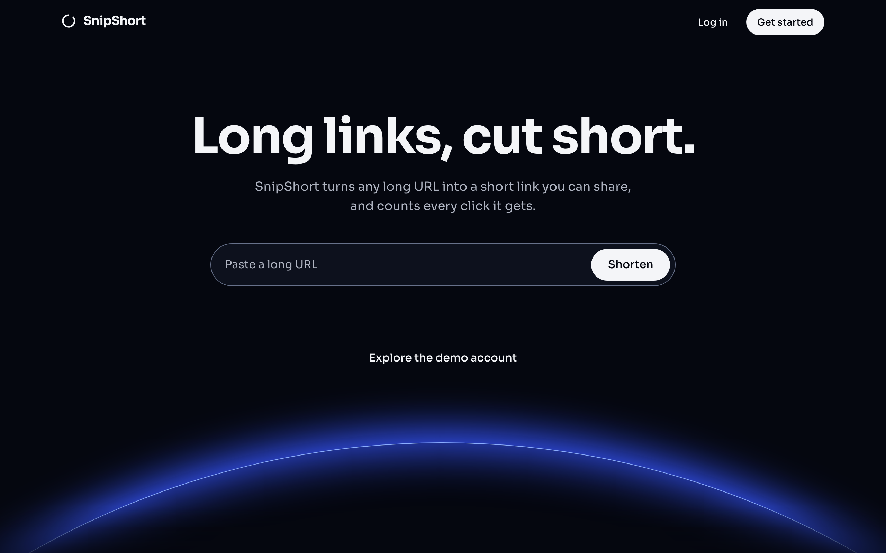

# SnipShort

**Long links, cut short.** SnipShort turns a long URL into a short link like `snipsh.com/aB3x9` and counts every click it gets.

**Live:** https://snipsh-swya.vercel.app
**Backend API:** https://github.com/soewaiyanag/snipsh-api

Try it with the demo account: `demo@snipsh.com` / `password123`



This was written with [Claude Code](https://claude.com/claude-code).

## The backend is the main feature

A short-link service is a backend. The pages in this repo are the front door; the part that makes SnipShort work is the **[snipsh-api](https://github.com/soewaiyanag/snipsh-api)** repository:

- **Redirects.** `GET /:slug` is public and answers with a `302` to the long URL. That is the whole product: someone opens `snipsh.com/aB3x9` and lands on the page it stands for.
- **Accounts.** Register and log in with email and password. Passwords are hashed, and requests carry a JWT.
- **Links.** Create a link with a random or a custom slug, and read or delete your own. A link belongs to one user, and anyone else gets a `404`. Slugs that would clash with real routes, such as `links` or `auth`, are rejected.
- **Built with** NestJS, Prisma and PostgreSQL.

```
 browser ──▶ snipsh.com/aB3x9 ──▶ API looks up the slug ──▶ 302 ──▶ the long URL
```

The frontend never handles the redirect; the API does. See the [API repository](https://github.com/soewaiyanag/snipsh-api) for its endpoints, data model and how to run it.

> **Status.** The API is still being built, so the live demo runs on a **mock API in the browser** (MSW) that follows the same contract. Links and accounts you create there reset when the page reloads. Click statistics and editing a link's address are drawn here from mock data and are not in the API yet.

## What the frontend does

- **Make a link in one step.** Paste a URL and press Shorten, or choose your own slug. The new short link appears at once with a Copy button.
- **Manage your links.** A paginated list with copy, inline edit and delete (asking first).
- **See the clicks.** Each link has a page with total clicks, a clicks-per-day chart, and a top-referrers table.
- **Try it without an account.** The landing page previews a short link in the browser, and the demo account is one click away.
- **Dark and light.** Dark is the designed look; the theme follows your system setting.
- **Works on a phone**, from 360px wide, with real labels, visible focus rings and keyboard-usable dialogs.

## Tech

| Area | Choice |
|---|---|
| Build | Vite, React, TypeScript (`strict`) |
| Routing | React Router |
| Server state | TanStack Query |
| Forms | React Hook Form and Zod |
| Styling | Tailwind CSS v4 and shadcn/ui |
| Charts | Recharts |
| Mock API | MSW (Mock Service Worker) |
| Tests | Vitest and Testing Library |

All HTTP lives in `src/api/`, behind one `fetch` wrapper that normalizes NestJS's error shapes. When the real API differs from the contract, only `src/api/` and `src/mocks/` change.

## Run it locally

Requires Node 22 or later and Yarn 1.

```bash
yarn install
cp .env.example .env
yarn dev
```

Open http://localhost:5173 and log in with the demo account above.

### Environment variables

| Variable | Example | Purpose |
|---|---|---|
| `VITE_API_URL` | `http://localhost:3000` | Base URL of the API. |
| `VITE_SHORT_DOMAIN` | `https://snipsh.com` | Base of every short link shown in the app. Set it to `http://localhost:3000` to test redirects against a local API. |
| `VITE_USE_MOCKS` | `true` | `true` answers API calls in the browser with MSW. `false` calls the real API. |

They are read and validated once, in `src/env.ts`. `.env` is not committed; `.env.example` is.

### Use the real API

1. Run [snipsh-api](https://github.com/soewaiyanag/snipsh-api) on port 3000 and allow CORS from `http://localhost:5173`.
2. Set `VITE_USE_MOCKS=false` in `.env` and restart `yarn dev`.

Nothing else changes. `BACKEND_REQUESTS.md` lists what the frontend needs from the API that its contract does not yet cover.

### Scripts

| Command | What it does |
|---|---|
| `yarn dev` | Starts the dev server on port 5173. |
| `yarn build` | Type-checks, then builds to `dist/`. |
| `yarn preview` | Serves the built app locally. |
| `yarn lint` | Runs ESLint. |
| `yarn test` | Runs the test suite once with Vitest. |

## Project layout

```
src/
  api/          fetch wrapper, one file per API area, contract types, Zod schemas
  components/   shared UI; shadcn/ui components are in components/ui
  features/
    auth/       login, register, auth context, route guard, token storage
    links/      create, list, edit, delete, link details
    stats/      clicks chart and referrers table
  lib/          formatting and short-link helpers
  mocks/        MSW handlers and the in-memory data
  pages/        landing page and 404
  test/         test setup and helpers
```

A `401` on any authenticated request clears the stored token; the route guard then sends the user to `/login` and brings them back to the page they wanted.

## Tests

`yarn test` covers the fetch client's error handling, the mock API against the contract, the login redirect and logout, the links page (pagination, creating a link, a taken slug, validation, an expired session), and the chart's day filling.
